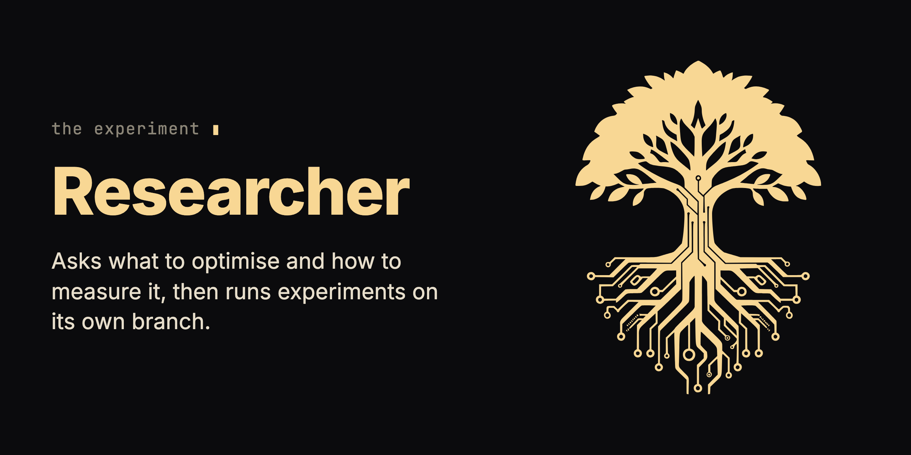

<p align="center"></p>

# Researcher Skill

**One file. Your AI coding agent becomes a scientist.**

Researcher turns your coding agent into an experiment loop: you agree on a metric, and the agent tries one change at a time on its own branch, keeps what moves the number and reverts what does not.

Ask an agent to make something faster and it changes things and tells you it is better. You have no baseline and no record of what it tried, so you can't check that.

[](https://github.com/krzysztofdudek/ResearcherSkill/releases/latest)
[](LICENSE)
[](https://github.com/krzysztofdudek/ResearcherSkill/stargazers)
[](https://github.com/krzysztofdudek/ResearcherSkill/discussions)

## What you install

In Claude Code:

```
/plugin marketplace add krzysztofdudek/ResearcherSkill
/plugin install researcher@researcher-marketplace
```

Then run `/reload-plugins` or restart Claude Code. No config, no API key.

| Piece | Where it lands | What it does | When it acts |
|---|---|---|---|
| The Researcher skill, one Markdown file ([`skills/researcher/SKILL.md`](skills/researcher/SKILL.md)) | your Claude Code plugins | Runs the interview, sets up the lab and drives the loop. | On `/researcher`, or when you ask to make something measurable better. |
| A branch `research/<slug>`, and more `research/...` branches when it forks | your local git | One commit per experiment; a discarded experiment is removed with `git reset --hard HEAD~1`, its commit id kept in the log. | During a run. |
| `.lab/` | repository root, untracked | The config, `results.tsv`, the log, the branch registry, the parking lot of ideas, a scratch workspace and, at the end, a summary. | From setup; it survives every git operation and lets the next session resume. |
| Two lines in `.gitignore` | your `.gitignore` | Ignore `.lab/` and `run.log`. | At setup. |
| `.lab/bin/` helpers and your tool's ignore file (for example `.claudeignore`) | `.lab/bin/` and the repository root | Keep each run's output short, to save tokens. | Only if you say yes to this in the interview. |

- **Never touches:** files outside the scope you agree on in the interview; it asks you when an experiment would need to. The skill has no step that pushes.
- **Needs:** git, and a way to measure: a command that prints a number, or a rubric you define together.
- **Costs:** the loop runs until you stop it or it reaches your target, unless you set a number of experiments. Each experiment runs your command, killed after the time budget you set (five minutes by default). With a rubric instead of a number, three evaluator subagents score each experiment.
- **In the agent's context:** the skill's description always; the body (about 3,300 words) when it runs; the lab files it re-reads before each experiment.

<details>
<summary>Other agents: GitHub Copilot CLI, Cursor, a plain skill folder</summary>

GitHub Copilot CLI:

```
copilot plugin marketplace add krzysztofdudek/ResearcherSkill
copilot plugin install researcher@researcher-marketplace
```

Cursor:

```
git clone https://github.com/krzysztofdudek/ResearcherSkill.git
ln -s "$(pwd)/ResearcherSkill" ~/.cursor/plugins/local/researcher
```

Then **Developer: Reload Window**.

A plain skill folder: copy [`skills/researcher/SKILL.md`](skills/researcher/SKILL.md) to `~/.claude/skills/researcher/SKILL.md` (user level) or `.claude/skills/researcher/SKILL.md` (project level), `~/.cursor/skills/researcher/SKILL.md` for Cursor, or wherever your agent reads skills. Trigger it by asking for "researcher mode".

</details>

## What changes on the first day

- Before any experiment, the agent asks what to optimise, how to measure it, what it may change and what is off limits, and reads the setup back for your yes.
- It records a baseline with no changes first.
- It commits before every experiment, logs the result, and keeps or resets the commit by the number.
- After three discards in a row it must write down why it continues; after five it forks to a different approach.
- When the session ends, the next one finds `.lab/` and asks whether to resume or start fresh.

## Start

1. Install with the two commands above, then run `/researcher` and say what you want better, for example "make `npm run build` faster".

   You see: the interview: the objective, the metric and its command, the scope, the constraints, the run command, the time budget, and when to stop. Then a compact table of the setup to confirm.

2. Confirm.

   You see: a new `research/<slug>` branch, `.lab/` created, two lines added to `.gitignore`, and experiment 0, the baseline, in `.lab/results.tsv`.

3. Let it work, and look in when you want.

   You see: one entry per experiment in `.lab/log.md`, each with its hypothesis, the change, the result against the best so far, and keep or discard.

4. Stop it, or let it reach your target.

   You see: `.lab/summary.md` with the experiments per branch, the best result against the baseline, the changes that mattered most and the ideas left untested. The kept work sits on the `research/` branch for you to merge or not.

The [guide](GUIDE.md) walks through a complete run from start to finish.

## What it does not do

- It does not invent a metric for you; if you can't measure the result, it builds a rubric with you, and a rubric is a judgment, not a measurement.
- It does not keep a change that did not move the number.
- It does not stop by itself unless you give it a target or a number of experiments.
- It has no step that merges its `research/` branch into yours; that stays your call.

## Remove it

In Claude Code:

```
claude plugin uninstall researcher@researcher-marketplace
claude plugin marketplace remove researcher-marketplace
```

On Copilot CLI, `copilot plugin uninstall researcher@researcher-marketplace`. On Cursor, delete the link in `~/.cursor/plugins/local/researcher`.

Then delete `.lab/` (the whole experiment history), the two lines it added to `.gitignore`, the `.lab/bin/` helpers and tool ignore file if you accepted them, and the `research/` branches you no longer want.

## Where it fits

Researcher is an add-on of the family: it attaches to the agent, depends on no other family tool and keeps its own version. Inside a Horde mission it runs the retrospective's measurement. It generalises the [autoresearch](https://github.com/karpathy/autoresearch) loop beyond machine learning, to anything you can measure.

Read more: [The guide](GUIDE.md) · [The skill](skills/researcher/SKILL.md) · [Changelog](CHANGELOG.md) · [Discussions](https://github.com/krzysztofdudek/ResearcherSkill/discussions) · [Report a problem](https://github.com/krzysztofdudek/ResearcherSkill/issues)

## The Yggdrasil family

**[Jarl](https://github.com/krzysztofdudek/JarlSkill)** is the loop. **[Yggdrasil](https://github.com/krzysztofdudek/Yggdrasil)** is the law. **[Grain](https://github.com/krzysztofdudek/Grain)** is the survey. **[Horde](https://github.com/krzysztofdudek/Horde)** plans the mission onto the law before anyone writes, lands every change through a gate no agent can argue with, and turns what the mission learned into law. It runs on Jarl's loop, with Grain in the architect's hands. Those four are the core, and they ship under one version number, Jarl on it from 6.1.0: one set of tools built and tested against each other. Yggdrasil, Grain and Jarl each work alone; Horde is the one built on the other three. Where a repository has a check, the check decides what lands, in a Horde mission and in a Jarl loop alike: a fresh reviewer can only stop a change, never make a failing check pass, and its word is recorded as testimony. A Jarl loop in a repository with no check lands on testimony alone, and says so. Law that stays inside one component is raised freely by the agent working it. Law or decisions that reach a whole type of code are shared vocabulary: the agent proposes them and they run as advice at once, and the client, the one person the whole system answers to, admits them in one batch when the work closes. Only the client lowers or vetoes law. The core's shared machine contracts are registered on [one page](https://krzysztofdudek.github.io/Yggdrasil/family-contracts).

Start at the step where it hurts.

| Where it hurts | Start with |
|---|---|
| More issues than one agent can hold in its head | **Jarl** |
| The agent keeps breaking what was agreed | **Yggdrasil** |
| Nobody knows what was agreed | **Grain**, which earns its keep the moment you are about to write law |
| A task too big for one head to plan up front, in a repository that already has law | **Horde** |

| Core | What it holds |
|---|---|
| **[Jarl](https://github.com/krzysztofdudek/JarlSkill)** | The loop. Everything seen becomes an issue, each issue gets one worker in its own worktree, nothing closes without evidence and a review, and no code closes without a fresh reviewer's word. Rulings keep their history, and a ruling about a whole type of code goes to the client in one batch when the loop closes. |
| **[Yggdrasil](https://github.com/krzysztofdudek/Yggdrasil)** | The law. The architecture graph, the rules over it and the log of why, checked before the agent moves on and re-proved in CI without a key. A rule that reaches a whole type runs as advice until the client ratifies it. |
| **[Grain](https://github.com/krzysztofdudek/Grain)** | The survey. Mines a repository's own code and history into a first graph: components, dependencies, and the rules the code already keeps, each with the count of places that break it today; Yggdrasil accepts it with one command. It measures and never blocks. |
| **[Horde](https://github.com/krzysztofdudek/Horde)** | The mission on the law. A one-shot architect plans the whole mission onto the graph once, measuring with Grain; a worker per ticket in its own worktree; every change lands through a nine-item gate; what the mission learned becomes law. Its record is a Jarl loop. The client orders the mission and is the only one who can lower or veto a rule. |

Three add-ons attach to the agent rather than to the graph; each works alone, depends on nothing in the family and keeps its own version. Horde doesn't assume any of them is installed, since it carries its own minimum discipline in each role's law. It uses Ratatoskr, Urd and Researcher when they are, one sentence per row below.

| Add-on | Stage | What it makes the agent prove | In Horde's loop |
|---|---|---|---|
| **[Ratatoskr](https://github.com/krzysztofdudek/RatatoskrSkill)** | request → intent | Keeps the agent talking to you in plain words, not code, so you can follow what it's doing. | Keeps the client's plain-language registry open at both ends of a mission. |
| **[Urd](https://github.com/krzysztofdudek/UrdSkill)** | intent → code | When the spec is ambiguous, it consults the source of truth and asks, it doesn't guess. | The stop a worker hits before it guesses. |
| **Researcher** (this one) | code → measured result | Point it at a metric and it runs experiments, hypotheses kept and discarded. | Runs the retrospective's measurement. |

## License

MIT. Made by [Krzysztof Dudek](https://github.com/krzysztofdudek).

---

<div align="center">
  
  <br/><br/>
  <a href="https://github.com/krzysztofdudek/ResearcherSkill/discussions">
    
  </a>
  <br/>
  <sub>Questions? Open a discussion on GitHub.</sub>
</div>
